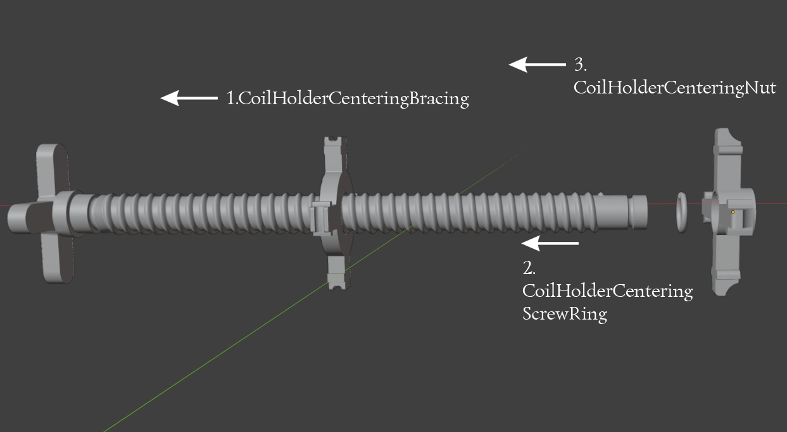
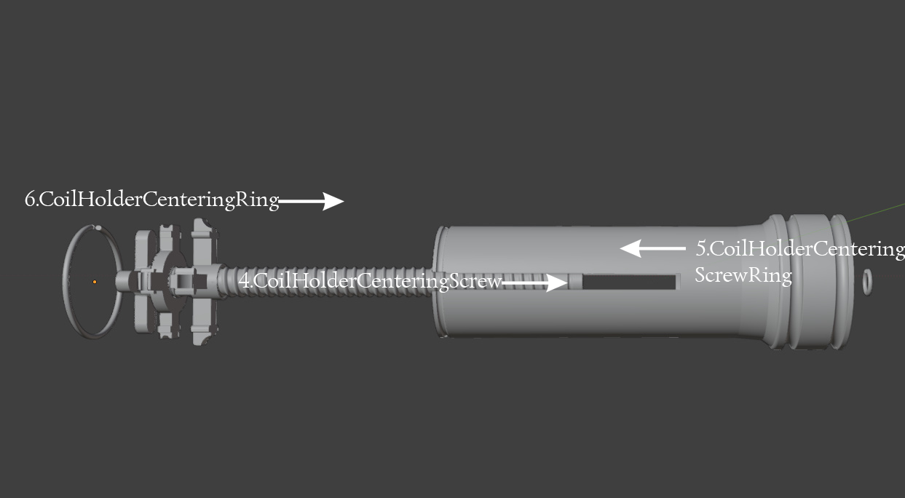
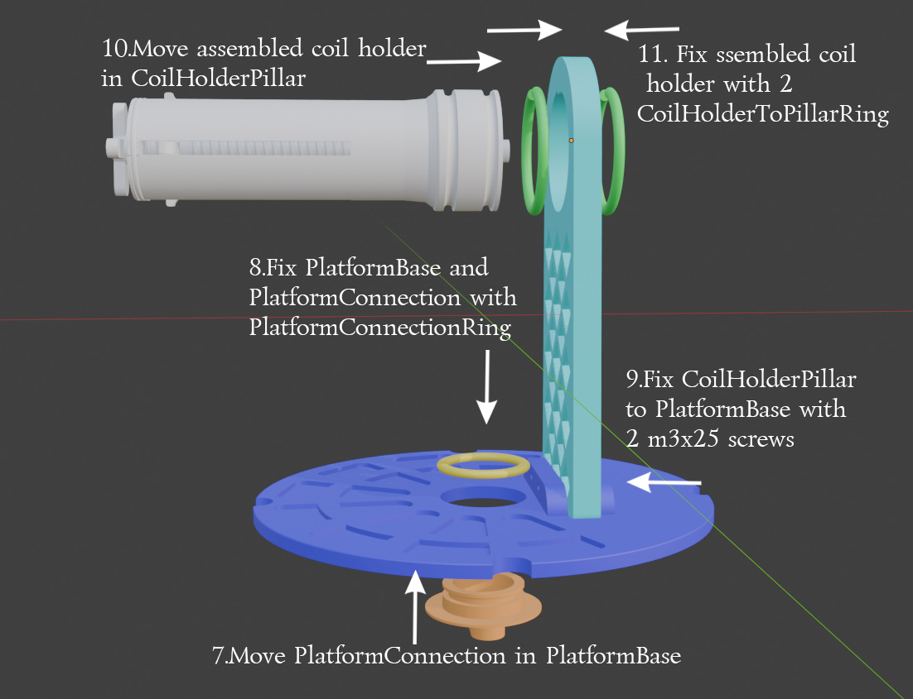
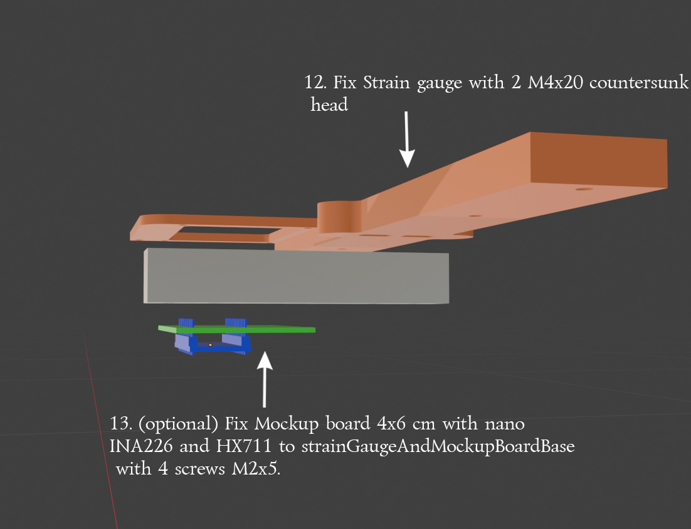
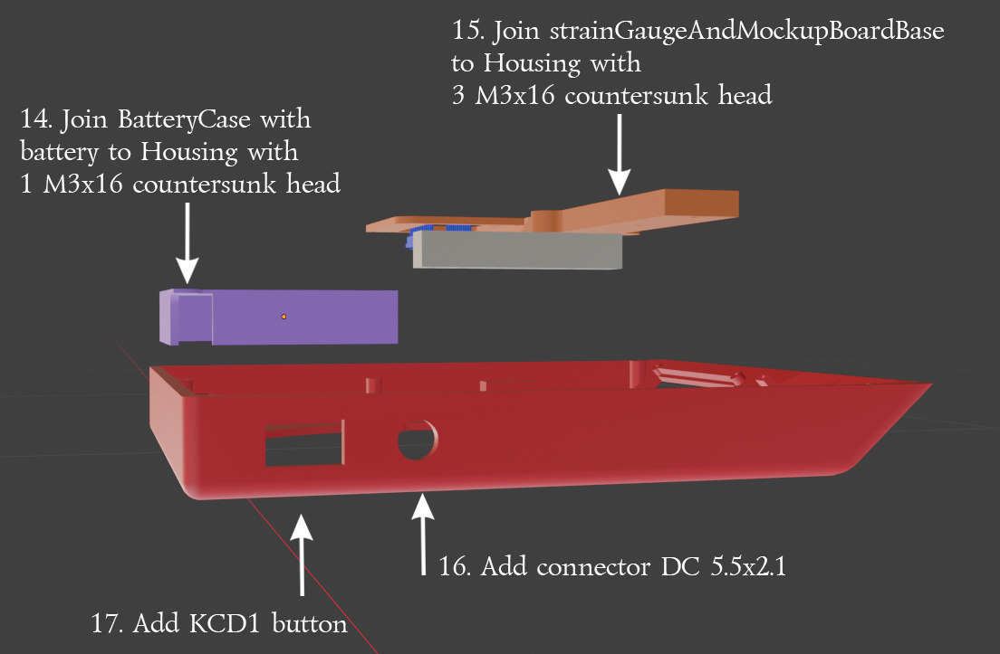
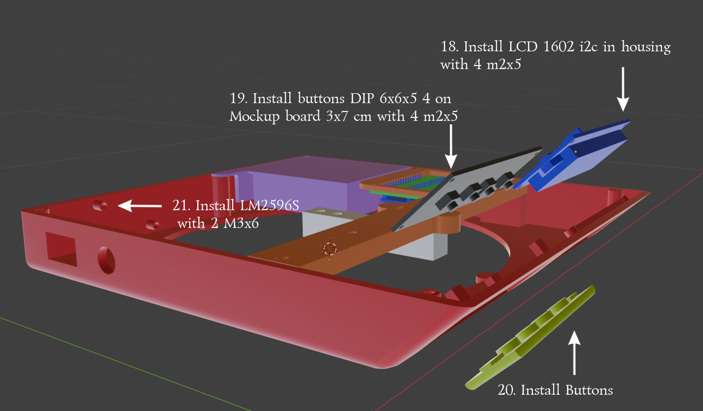
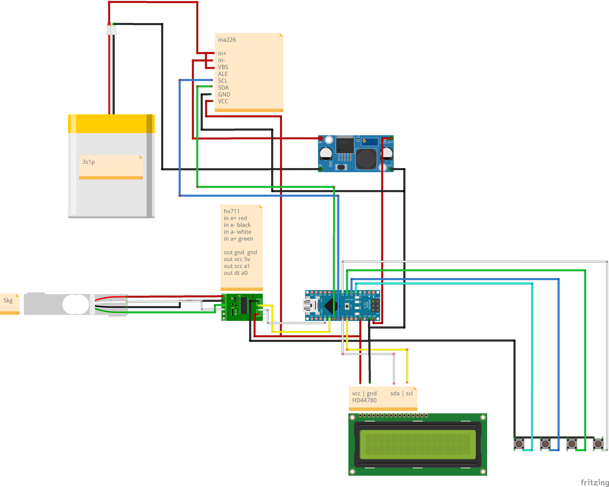

# FilamentHolderWithScales
Filament holder with scales instruction
https://www.thingiverse.com/thing:7420242

English

### Required parts:
1.	Arduino nano v3
2.	LCD 1602 i2c
3.	Strain gauge YZC-131 5KG
4.	HX711
5.	LM2596s set out to 5v
6.	Battery 3p1s
7.	INA226
8.	Connector DC 5.5x2.1
9.	KCD1 button
10.	Mockup board 3x7 cm
11.	Mockup board 4x6 cm
12.	Buttons DIP 6х6х5 mm 4
13.	M3x25 2
14.	M4x20 countersunk head 4
15.	M2x5 12 (may use 6, connect diagonal)
16.	M3x16 countersunk head 10
17.	M3x6 2

## Assembling
### 1.Coil holder
Parts (stl files):
1.	CoilHolder
2.	CoilHolderCenteringBracing
3.	CoilHolderCenteringNut
4.	CoilHolderCenteringRing
5.	CoilHolderToPillarRing X2
6.	CoilHolderСenteringScrew
7.	CoilHolderСenteringScrewRing X2

### 1.1 coil centering screw

1.	Move CoilHolderCenteringBracing to end of CoilHolderСenteringScrew
2.	Fix CoilHolderCenteringBracing with CoilHolderСenteringScrewRing
3.	Twist CoilHolderCenteringNut to CoilHolderСenteringScrew

### 1.2	coil holder

4. Add assembled centering screw in coil holder
5. Fix assembled centering screw with CoilHolderСenteringScrewRing
6. Fix coil holder and centering screw with CoilHolderCenteringRing

### 2.Platform
   Parts (stl files and assembled parts):
1.	Assembled coil holder
2.	CoilHolderPillar
3.	PlatformBase
4.	PlatformConnectionRing
5.	PlatformConnection

### 2.1 platform

7.	Move PlatformConnection in PlatformBase
8.	Fix PlatformConnection in PlatformBase with CoilHolderToPillarRing
9.	Fix CoilHolderPillar and PlatformBase with 2 m3x25 screws
10.	 Move assembled coil holder in CoilHolderPillar
11.	 Fix assembled coil holder in CoilHolderPillar with 2 CoilHolderToPillarRing

### 3.Housing
Parts (stl files and components):
1.	Housing
2.	Strain gauge YZC-131 5KG
3.	LCD 1602 i2c
4.	BatteryCase
5.	strainGaugeAndMockupBoardBase
6.	Buttons DIP 6х6х5 4 on Mockup board 3x7 cm
7.	Mockup board 4x6 cm with nano INA226 and HX711. (Mockup board 4x6 is optional)
8.	LM2596S
9.	Battery 3p1s
10.	M4x20 countersunk head 4
11.	M3x16 countersunk head 10
12.	M3x6 2
13.	M2x5 12 (may use 6, connect diagonal)
14.	Connector DC 5.5x2.1
15.	KCD1 button
### 3.1 Strain gauge and mockup board base

16. 12.	Connect strain gauge to strainGaugeAndMockupBoardBase with 2 screws M4x20 countersunk head
13.	 Fix Mockup board 4x6 cm with nano INA226 and HX711 to strainGaugeAndMockupBoardBase with 4 screws M2x5.

* This is not necessary and is done to organize the components, the components can be placed arbitrarily in the housing,
the main thing is that they do not touch the strain gauge
  
### 3.2 Housing assembling 1

14.	Add battery box with battery before strainGaugeAndMockupBoardBase because second connection of battery box common with Board base
15.	Join strainGaugeAndMockupBoardBase to housing
16.	Add charging connector
17.	Add on\off button

### 3.2 Housing assembling 2

18.	Install LCD 1602 i2c in housing with 4(or 2) m2x5, there is a cutout for the screen
19.	 Install buttons with m2x5 screws
20.	 Install Buttons, press the plate from both sides to insert it into the grooves
21.	 Install LM2596s in housing with 2 M3x6
        After full assembling and connecting all components, you can cover housing with bottom plate (HousingBottom)
* Do not install the weighing platform before the first activation. The first stage of calibration is performed without the weighing platform

# Connecting components
For the wiring diagram, some components could not be found; in their place, comments with connector markings were used.
The project uses a battery with an integrated BMS for charging and powering the device, so there is no separate charging circuit.
Battery charge is measured using the INA226 module.
The arduino nano is powered by the LM2596s 12V to 5v, LCD1602 hx711 and INA226 are connected to the corresponding GND and 5v pins.

# Instructions for Use
Do not install the weighing platform before the first activation; the first stage of load cell calibration is carried out without the platform.
Error messages are explained at the end of the section.
The measurement step is 5 g to reduce the impact of vibrations on the measurement.
All variables necessary for the operation of the scales are stored in non‑volatile memory, so the device is not affected by power outages or battery discharge.
## First activation
Message: Calibration required o-5 sec
You need to hold the button "o" for 5 seconds to start the calibration.

Message: Remove platform +done -cancel
To start the calibration, you need to remove the platform; re‑calibration is possible at any time; to do this, hold the button "o" for 5 seconds.

Message: Without platform Starts 5 sec
Before calibration without a load, a countdown occurs after pressing the + button to reduce the impact of interaction with the device on the measurement.

Message: Install platform +done -cancel
After calibration without a load, you need to install a platform weighing 232 g (weight of the plastic + screws at the time the instructions were written).
## Calibration end
## Install new coil
Once press "o" button
Message: Install new coil +ok -cancel
Start set new coil

Message: 1000g? +ok o change -cancel
Default filament weight 1000g If the weight of the filament is different, you can change the measured weight by pressing the "o" button.

Message: Start: 1000g +/-   o ok
Pres +/- to change start weight value, hold to increase step, "o" – confirm
# Sleep
After 30 seconds of inactivity, the screen backlight turns off, pressing any button turns it on; it’s better to use the dedicated sleep button (button 4).

# Errors
### No signal from HX711
Message: Waiting HX711...
This may be caused by a lack of contact between the Arduino Nano and the HX711, or between the HX711 and the load cell, the cause may also be a malfunction of the HX711.

### Battery charge measurement error
Message: ---- In the battery charge indicator in the lower right corner of screen.
This may be caused by a lack of contact between the Arduino Nano and the INA226, or between the INA226 and the Battery, the cause may also be a malfunction of the INA226.
### Measurement error when installing a new coil
When installing a new coil, an error may occur if the weight cannot be determined after 3 attempts.
Make sure the load cell is installed correctly, the bolts are tightened, the platform does not touch the housing, and there is no HX711 error.

Русский

# Необходимые компоненты

1. Arduino Nano v3
2. LCD 1602 i2c
3. Тензодатчик YZC-131 5KG
4. HX711
5. LM2596s с выходным напряжением, настроенным на 5 В
6. Аккумулятор 3p1s
7. INA226
8. Разъём DC 5.5x2.1
9. Выключатель KCD1
10. Макетная плата 3×7 см
11. Макетная плата 4×6 см
12. Кнопки DIP 6×6×5 мм - 4 шт.
13. Винты M3x25 - 2 шт.
14. Винты M4x20 с потайной головкой - 4 шт.
15. Винты M2x5 - 12 шт. (можно использовать 6 шт., закрепляя по диагонали)
16. Винты M3x16 с потайной головкой - 10 шт.
17. Винты M3x6 - 2 шт.

# Сборка

## 1. Держатель катушки

Детали (STL-файлы):

1. CoilHolder
2. CoilHolderCenteringBracing
3. CoilHolderCenteringNut
4. CoilHolderCenteringRing
5. CoilHolderToPillarRing - 2 шт.
6. CoilHolderСenteringScrew
7. CoilHolderСenteringScrewRing - 2 шт.

### 1.1. Центрирующий винт катушки

1. Наденьте CoilHolderCenteringBracing на конец CoilHolderСenteringScrew.
2. Зафиксируйте CoilHolderCenteringBracing с помощью CoilHolderСenteringScrewRing.
3. Накрутите CoilHolderCenteringNut на CoilHolderСenteringScrew.

### 1.2. Держатель катушки

4. Вставьте собранный центрирующий винт в держатель катушки.
5. Зафиксируйте собранный центрирующий винт с помощью CoilHolderСenteringScrewRing.
6. Соедините держатель катушки и центрирующий винт с помощью CoilHolderCenteringRing.

## 2. Платформа

Детали (STL-файлы и собранные узлы):

1. Собранный держатель катушки
2. CoilHolderPillar
3. PlatformBase
4. PlatformConnectionRing
5. PlatformConnection

### 2.1. Платформа

7. Вставьте PlatformConnection в PlatformBase.
8. Зафиксируйте PlatformConnection в PlatformBase с помощью CoilHolderToPillarRing.
9. Соедините CoilHolderPillar и PlatformBase двумя винтами M3x25.
10. Вставьте собранный держатель катушки в CoilHolderPillar.
11. Зафиксируйте собранный держатель катушки в CoilHolderPillar с помощью двух CoilHolderToPillarRing.

## 3. Корпус

Детали (STL-файлы и компоненты):

1. Housing
2. Тензодатчик YZC-131 5KG
3. LCD 1602 i2c
4. BatteryCase
5. strainGaugeAndMockupBoardBase
6. Кнопки DIP 6×6×5 - 4 шт. на макетной плате 3×7 см
7. Макетная плата 4×6 см с Arduino Nano, INA226 и HX711 (макетная плата 4×6 см необязательна)
8. LM2596S
9. Аккумулятор 3p1s
10. Винты M4x20 с потайной головкой - 4 шт.
11. Винты M3x16 с потайной головкой - 10 шт.
12. Винты M3x6 - 2 шт.
13. Винты M2x5 - 12 шт. (можно использовать 6 шт, закрепляя по диагонали)
14. Разъём DC 5.5x2.1
15. Выключатель KCD1

### 3.1. Основание для тензодатчика и макетной платы

12. Прикрепите тензодатчик к strainGaugeAndMockupBoardBase двумя винтами M4x20 с потайной головкой.
13. Прикрепите макетную плату 4×6 см с Arduino Nano, INA226 и HX711 к strainGaugeAndMockupBoardBase четырьмя винтами M2x5.

* Этот шаг необязателен и нужен для упорядоченного размещения компонентов. Компоненты можно расположить в корпусе произвольно; главное, чтобы они не касались тензодатчика.

### 3.2. Сборка корпуса, часть 1

14. Установите аккумуляторный отсек с аккумулятором до установки strainGaugeAndMockupBoardBase, поскольку вторая точка крепления аккумуляторного отсека общая с основанием платы.
15. Прикрепите strainGaugeAndMockupBoardBase к корпусу.
16. Установите разъём для зарядки.
17. Установите выключатель питания.

### 3.2. Сборка корпуса, часть 2

18. Установите LCD 1602 i2c в корпус, закрепив его четырьмя (или двумя) винтами M2x5. Для экрана предусмотрен вырез.
19. Закрепите кнопки винтами M2x5.
20. Установите кнопки: сожмите пластину с двух сторон, чтобы вставить её в пазы.
21. Установите LM2596s в корпус, закрепив его двумя винтами M3x6.

После завершения сборки и подключения всех компонентов можно закрыть корпус нижней крышкой (HousingBottom).

* Не устанавливайте платформу для взвешивания до первого включения. Первый этап калибровки выполняется без платформы.

# Подключение компонентов

Некоторые компоненты не удалось найти для схемы подключения; вместо них использованы комментарии с обозначениями контактов разъёмов.

В проекте используется аккумулятор со встроенной BMS для зарядки и питания устройства, поэтому отдельная схема зарядки отсутствует.

Уровень заряда аккумулятора измеряется с помощью модуля INA226.

Arduino Nano питается от LM2596s, преобразующего напряжение с 12 В до 5 В. LCD1602, HX711 и INA226 подключены к соответствующим контактам GND и 5 В.

# Инструкция по использованию

Не устанавливайте платформу для взвешивания до первого включения: первый этап калибровки тензодатчика выполняется без платформы.

Сообщения об ошибках описаны в конце раздела.

Шаг измерения составляет 5 г, чтобы уменьшить влияние вибраций на результат измерения.

Все переменные, необходимые для работы весов, хранятся в энергонезависимой памяти, поэтому отключение питания или разряд аккумулятора не приводят к их потере.

## Первое включение

Сообщение: Calibration required o-5 sec "Требуется калибровка o-5 сек"

Для запуска калибровки удерживайте кнопку "o" в течение 5 секунд.

Сообщение: Remove platform +done -cancel "Удалите платформу +готово -отмена"

Для начала калибровки необходимо снять платформу. Повторную калибровку можно выполнить в любой момент: для этого удерживайте кнопку "o" в течение 5 секунд.

Сообщение: Without platform Starts 5 sec "Без платформы начнется через 5 сек"

После нажатия кнопки "+" начинается обратный отсчёт перед калибровкой без нагрузки. Это позволяет уменьшить влияние взаимодействия с устройством на результат измерения.

Сообщение: Install platform +done -cancel "Установите платформу +готово -отмена"

После калибровки без нагрузки необходимо установить платформу массой 232 г (масса пластиковых деталей и винтов на момент написания инструкции).

## Калибровка завершена.

## Установка новой катушки

Однократно нажмите кнопку "o".

Сообщение: Install new coil +ok -cancel "Установить новую катушку, + ОК, - отмена"

Начните установку новой катушки.

Сообщение: "1000 г? + ОК, o изменить, - отмена"

Масса филамента по умолчанию составляет 1000 г. Если масса филамента отличается, её значение можно изменить нажатием кнопки "o".

Сообщение: 1000g? +ok o change -cancel "Начальная масса: 1000 г, +/-, o ОК"

Нажимайте "+" или "-", чтобы изменить начальную массу. Удерживайте кнопку для увеличения шага изменения. Нажмите "o" для подтверждения.

# Спящий режим

После 30 секунд бездействия подсветка экрана отключается. Нажатие любой кнопки включает её; предпочтительно использовать отдельную кнопку спящего режима (кнопка 4).

# Ошибки

### Нет сигнала от HX711

Сообщение: Waiting HX711...  "Ожидание HX711..."

Причиной может быть отсутствие контакта между Arduino Nano и HX711 или между HX711 и тензодатчиком, а также неисправность HX711.

### Ошибка измерения заряда аккумулятора

Сообщение: "----" в индикаторе заряда аккумулятора в правом нижнем углу экрана.

Причиной может быть отсутствие контакта между Arduino Nano и INA226 или между INA226 и аккумулятором, а также неисправность INA226.

### Ошибка измерения при установке новой катушки

При установке новой катушки может возникнуть ошибка, если не удаётся определить массу за 3 попытки.

Убедитесь, что тензодатчик установлен правильно, болты затянуты, платформа не касается корпуса и отсутствует ошибка HX711.

